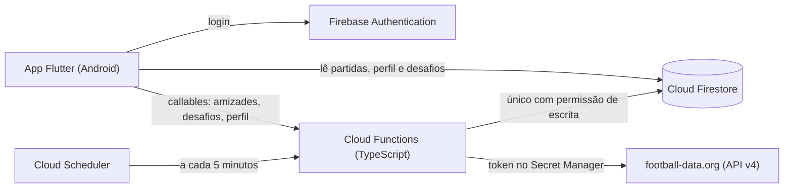

# BetFriends

Aplicativo Android, feito em Flutter, para desafios 1x1 entre amigos sobre partidas reais do Campeonato Brasileiro Série A. Dois amigos escolhem uma partida, registram palpites diferentes e apostam **BetCoins**, uma moeda fictícia que não pode ser comprada, vendida, sacada nem convertida em dinheiro. Quando a partida termina, o resultado oficial define quem ganha.

Projeto Final da disciplina de Desenvolvimento Mobile.

## Sumário

- [Como o jogo funciona](#como-o-jogo-funciona)
- [Arquitetura](#arquitetura)
- [Tecnologias](#tecnologias)
- [Preparando o ambiente](#preparando-o-ambiente) (Windows e Linux)
- [Rodando o app](#rodando-o-app)
- [Backend e testes](#backend-e-testes)
- [Build de release](#build-de-release-android)
- [Configuração do Firebase e segurança](#configuração-do-firebase-e-segurança)
- [Estrutura do repositório](#estrutura-do-repositório)
- [Integração contínua e fluxo de trabalho](#integração-contínua-e-fluxo-de-trabalho)
- [Documentação](#documentação)
- [Solução de problemas](#solução-de-problemas)

## Como o jogo funciona

1. **Conta e carteira.** O usuário se cadastra com e-mail e senha, escolhe um username único e recebe **1.000 BetCoins**. O Perfil mostra o extrato de BetCoins e permite **excluir a conta** (sem desafio em andamento nem saldo reservado): o perfil, as amizades e a conta de acesso são apagados e o username volta a ficar livre; o extrato e os desafios já encerrados permanecem, sem dados pessoais.
2. **Amizades.** Só amigos se desafiam: busca por username, solicitação, aceite ou recusa. Uma amizade aceita pode ser removida, desde que não haja desafio em andamento entre os dois; depois disso, só voltam a se desafiar com uma nova amizade. O login aceita e-mail ou username.
3. **Desafio.** Um usuário escolhe um amigo, uma partida que ainda não começou, um valor (de **10 a 500** BetCoins) e o palpite (vitória do mandante, empate ou vitória do visitante). O valor fica **reservado** na carteira dele.
4. **Aceite.** O amigo aceita com um palpite **diferente** do primeiro, e o mesmo valor é reservado na carteira dele. Ele também pode recusar. Desafio pendente que não é aceito expira, e o criador pode cancelá-lo.
5. **Partida.** Criar e aceitar só é possível até 5 minutos antes do início. O backend acompanha a partida e inicia o desafio quando ela começa.
6. **Resultado.** Quando a partida termina, o backend liquida o desafio sozinho, com base no resultado oficial do provedor de dados:
   - quem acertou recebe o valor apostado pelo adversário (o total do desafio é 2x o valor, **sem taxa**);
   - se nenhum dos dois acertou, cada um recebe a própria reserva de volta;
   - se a partida for cancelada ou adiada além do tolerado, o desafio é cancelado e as reservas são devolvidas.
7. **Recuperação (RF-020).** A Home oferece **Resgatar bônus de recuperação (+100 BetCoins)** junto à carteira somente com saldo disponível abaixo de 10, nenhuma reserva e pelo menos 24 horas desde o último bônus. Durante o intervalo, informa a data e a hora local do próximo resgate; outras condições ocultam a ação. O servidor valida as regras pela callable `claimRecoveryBonus`; o saldo se atualiza pelo stream do perfil, sem escrita local. Sem confirmação do servidor, a tela informa o erro e não repete automaticamente: confira a carteira antes de tentar novamente.

Estados de um desafio: `PENDING` → `ACCEPTED` → `IN_PROGRESS` → `WAITING_RESULT` → `FINISHED`, com saídas para `REJECTED`, `EXPIRED` e `CANCELLED`. Toda movimentação de saldo é registrada em um extrato imutável (ledger), e as operações financeiras são transações atômicas.

## Arquitetura



Princípios do projeto:

- **O backend é a única autoridade sobre dinheiro e estado.** O app não escreve saldo, extrato, amizades, partidas nem desafios; só altera o próprio nome de exibição. As Security Rules bloqueiam todo o resto.
- **O app nunca chama a API de futebol.** A função agendada `syncMatches` consulta o provedor (a cada 5 minutos para a janela próxima e a temporada inteira a cada 6 horas, por padrão), grava as partidas no Firestore e processa os desafios: inicia, expira, cancela e liquida. O app só lê `matches`.
- **Identidade vem do token.** Toda função tira o UID do usuário autenticado, nunca do payload.
- **Segredos ficam fora do repositório.** O token da football-data.org está no Secret Manager do Google Cloud.

São 17 funções exportadas em `functions/src/index.ts`: 16 callables e a agendada `syncMatches`.

## Tecnologias

| Camada | Tecnologia |
|---|---|
| App | Flutter 3.47 (canal stable) e Dart 3.13+, Android |
| Estado e navegação | Provider; Navigator com `AuthGate` baseado na sessão |
| Autenticação | Firebase Authentication (e-mail e senha) |
| Banco de dados | Cloud Firestore, com Security Rules e índices versionados (`firestore.rules`, `firestore.indexes.json`) |
| Backend | Cloud Functions 2ª geração em TypeScript, Node 22, região `southamerica-east1` |
| Dados de futebol | [football-data.org](https://www.football-data.org) API v4, campeonato `BSA` |
| Testes | `flutter test`, `node --test` e Firebase Emulator Suite |
| CI | GitHub Actions |

## Preparando o ambiente

### O que você precisa

| Para quê | Ferramenta | Versão |
|---|---|---|
| Rodar o app | Git | qualquer recente |
| | Flutter | 3.47 (stable), com Dart 3.13.3 ou superior |
| | Android SDK e um emulador (AVD) ou aparelho com depuração USB | pelo Android Studio |
| | JDK para o build Android | 17 ou superior (o JDK do Android Studio serve) |
| Backend e testes de emulador (opcional) | Node.js | 22 |
| | JDK para o Firestore Emulator | **21 ou superior** |
| Publicar o backend (só quem tem acesso ao projeto) | Firebase CLI | 15.32.1, instalado pelo npm |

Para só rodar o app **não é preciso** instalar Node, Firebase CLI nem configurar o Firebase: a configuração de cliente já está no repositório e o backend já está publicado.

### Windows

Use o PowerShell.

```powershell
# 1. Git e Android Studio (inclui Android SDK, emulador e JDK)
winget install --id Git.Git -e
winget install --id Google.AndroidStudio -e

# 2. Flutter: baixe o zip do canal stable em https://docs.flutter.dev/get-started/install/windows
#    e extraia em um caminho sem espaços, por exemplo C:\src\flutter.
#    Depois adicione C:\src\flutter\bin ao PATH do usuário e abra um novo terminal.

# 3. Modo de desenvolvedor: o Flutter precisa dele para criar links simbólicos de plugins
start ms-settings:developers      # ative "Modo de Desenvolvedor"

# 4. Licenças do Android e diagnóstico
flutter doctor --android-licenses
flutter doctor
```

Abra o Android Studio uma vez, conclua o assistente do SDK (inclua *Android SDK Command-line Tools*) e crie um emulador em **Device Manager**. Para acelerar o emulador, ative a virtualização na BIOS e o recurso *Windows Hypervisor Platform* do Windows.

Se for rodar o backend ou os testes de emulador, instale também o Node 22 pelo [nvm-windows](https://github.com/coreybutler/nvm-windows) (`nvm install 22` e `nvm use 22`) e um JDK 21 (por exemplo `winget install --id EclipseAdoptium.Temurin.21.JDK -e`). Rode os comandos de emulador do `bash` mais abaixo no **WSL** ou no **Git Bash**, não no PowerShell.

### Linux

Os passos são os mesmos em qualquer distribuição; muda só o instalador de pacotes.

```bash
# 1. Ferramentas básicas
sudo apt install -y git curl unzip xz-utils zip     # Debian/Ubuntu
# sudo dnf install -y git curl unzip xz zip         # Fedora
# sudo pacman -S --needed git curl unzip base-devel # Arch

# 2. Flutter (canal stable)
git clone https://github.com/flutter/flutter.git -b stable ~/development/flutter
echo 'export PATH="$HOME/development/flutter/bin:$PATH"' >> ~/.bashrc   # ou ~/.zshrc
source ~/.bashrc

# 3. Android Studio: baixe em https://developer.android.com/studio (ou, no Arch, `yay -S android-studio`).
#    Abra uma vez, conclua o assistente do SDK e crie um emulador em Device Manager.

# 4. Aceleração do emulador (KVM)
sudo usermod -aG kvm "$USER"      # depois encerre a sessão e entre de novo

# 5. Licenças do Android e diagnóstico
flutter doctor --android-licenses
flutter doctor
```

Para o backend e os testes de emulador, instale o Node 22 (pelo [nvm](https://github.com/nvm-sh/nvm): `nvm install 22`) e um JDK 21 (`sudo apt install openjdk-21-jdk`, `sudo dnf install java-21-openjdk` ou `sudo pacman -S jdk21-openjdk`). Confira com `java -version`.

Em qualquer sistema, o `flutter doctor` deve mostrar **Flutter** e **Android toolchain** sem problemas. A falta do Chrome ou do Visual Studio não afeta o build Android.

## Rodando o app

```bash
git clone https://github.com/Matheusv1007/bet-friends.git
cd bet-friends
git switch qas          # branch de integração: contém o código atual do app
flutter pub get
```

O desenvolvimento acontece na branch `qas`; o trabalho novo entra por pull request para ela.

### No emulador ou em um aparelho

```bash
flutter emulators                          # lista os emuladores (AVDs)
flutter emulators --launch <id_do_avd>     # abre um emulador
flutter devices                            # confira que o dispositivo aparece
flutter run                                # ou: flutter run -d <id_do_dispositivo>
```

Em um aparelho físico, ative as **Opções do desenvolvedor** e a **Depuração USB**, conecte o cabo e aceite a autorização no celular. Com o app aberto, `r` faz hot reload, `R` faz hot restart e `q` encerra.

O app usa o projeto Firebase real da equipe. As contas e os dados que você criar são permanentes: use e-mails fictícios e combine com a equipe antes de criar contas de teste. Para um teste completo é preciso duas contas que sejam amigas.

### Outros comandos

```bash
flutter analyze                 # análise estática (deve terminar sem avisos)
flutter test                    # testes de unidade e de widget
flutter build apk --debug       # gera build/app/outputs/flutter-apk/app-debug.apk
```

## Backend e testes

As Cloud Functions ficam em `functions/` e já estão publicadas. Você só precisa desta seção para alterar o backend ou rodar os testes dele. Nenhum teste automatizado usa o Firebase de produção: tudo roda no Firestore Emulator com o projeto fictício `demo-betfriends`.

```bash
cd functions
npm ci
npm test                        # compila e roda os testes puros (os de emulador são pulados)
```

O `npm test` funciona igual no Windows e no Linux.

### Testes com o Firestore Emulator

Rodam na **raiz** do repositório, depois do `npm ci` e do `npm run build` em `functions/`, com JDK 21 como Java padrão (`java -version`). Use `bash` (Linux, WSL ou Git Bash):

```bash
# backend e Security Rules juntos, como no CI
functions/node_modules/.bin/firebase emulators:exec --only firestore --project demo-betfriends \
  "$(command -v node) --test --test-concurrency=1 'functions/lib/test/**/*.test.js' 'tests/firestore-rules/*.test.mjs'"
```

- Os padrões de arquivo ficam entre aspas simples, porque o `node --test` do Node 22 não aceita pasta como argumento.
- `--test-concurrency=1` é obrigatório: os arquivos limpam o emulador.
- O emulador usa portas fixas (8080 para o Firestore). Não rode duas execuções ao mesmo tempo; se precisar, serialize com `flock`.

Os testes de integração do app no Android contra os emuladores estão em [`integration_test/README.md`](integration_test/README.md). Eles exigem um aparelho ou emulador Android e não rodam no CI.

### Publicar o backend

Só quem tem acesso ao projeto `betfriends-unirv-2026` publica. Use o CLI instalado **pelo npm** com Node 22, não o binário standalone, que quebra o passo de compilação do deploy:

```bash
npx firebase-tools@15.32.1 login
npx firebase-tools@15.32.1 deploy --only firestore:indexes --project betfriends-unirv-2026
npx firebase-tools@15.32.1 deploy --only firestore:rules,functions --project betfriends-unirv-2026
```

Publique os índices primeiro e espere ficarem ativos. O guia completo (segredos, rotação do token, App Check, emuladores) está em [`docs/callable-functions.md`](docs/callable-functions.md).

## Build de release (Android)

O release é assinado com um keystore descrito em `android/key.properties`, que **nunca vai para o git** (`key.properties`, `*.jks` e `*.keystore` já estão no `.gitignore`). Gere o keystore uma única vez e guarde o arquivo e as senhas fora do repositório, com backup.

```bash
# Linux
keytool -genkeypair -v -keystore ~/betfriends-release.jks -alias betfriends \
  -keyalg RSA -keysize 2048 -validity 10000
```

```powershell
# Windows: o keytool vem no JDK do Android Studio
& "C:\Program Files\Android\Android Studio\jbr\bin\keytool.exe" -genkeypair -v `
  -keystore "$env:USERPROFILE\betfriends-release.jks" -alias betfriends `
  -keyalg RSA -keysize 2048 -validity 10000
```

Crie `android/key.properties` (no Windows, use `/` ou `\\` no caminho):

```properties
storeFile=/caminho/absoluto/betfriends-release.jks
storePassword=<senha do keystore>
keyAlias=betfriends
keyPassword=<senha da chave>
```

Depois rode `flutter build apk --release` ou `flutter build appbundle --release`. Sem `android/key.properties`, o Gradle avisa e assina com a chave de debug: serve só para `flutter run --release`, e o artefato não é publicável. Ao trocar de keystore, registre o novo SHA-1 no Firebase e na restrição da chave de API.

## Configuração do Firebase e segurança

- **Cliente:** o repositório inclui `android/app/google-services.json`, que identifica o projeto Firebase do app. Ele não é credencial administrativa e dispensa qualquer configuração para rodar o app.
- **Chave de API:** a chave `AIza…` do `google-services.json` é de cliente, mas deve ser restrita no Google Cloud Console (APIs e serviços, Credenciais) ao pacote `com.unirv.betfriends` e ao SHA-1 do keystore, e só às APIs do Firebase usadas.
- **Security Rules:** o cliente lê o próprio perfil e carteira, as amizades e os desafios de que participa, as partidas (qualquer usuário autenticado) e o próprio extrato. O cliente só escreve o próprio nome de exibição; todas as demais escritas são exclusivas do backend. Caminhos não declarados são bloqueados.
- **Segredos:** o token da football-data.org fica no Secret Manager (`FOOTBALL_DATA_TOKEN`) e só o backend o lê. Nunca versione tokens, chaves de serviço, keystores nem `.secret.local`.
- **Configuração pública do backend:** `functions/.env.betfriends-unirv-2026` é versionado e só contém a agenda da sincronização e o interruptor do App Check (`ENFORCE_APP_CHECK`). O app já envia o token do App Check; o backend só o exige quando essa variável é `true`.
- **Uso justo:** busca de usuários, criação e cancelamento de desafios e solicitações de amizade têm limite de uso no servidor.

## Estrutura do repositório

```text
lib/                             # app Flutter
├── main.dart, app.dart          # inicialização do Firebase, providers e AuthGate
├── telas_autenticacao/          # Login e Cadastro
├── telas_principais/            # Home
├── tela_perfil/                 # Perfil e edição do nome
├── tela_criar_desafio/          # Criar Desafio
├── tela_amigos/                 # busca, solicitações e lista de amigos
├── tela_sobre/                  # informações e créditos
├── widgets_home_page/           # componentes da Home
├── provider/                    # AuthProvider, PartidasProvider
├── services/                    # autenticação, desafios, amizades, perfil, chamadas às Functions
├── models/                      # partida, perfil, carteira, desafio, amizade
└── data/firestore/              # coleções e repositórios do Firestore
functions/src/                   # Cloud Functions (TypeScript)
├── core/                        # autenticação, validação, base das callables, limite de uso, segredos
├── perfil/                      # criação de perfil e busca de usuários
├── amigos/                      # solicitações e lista de amizades
├── betcoins/                    # carteira, reservas, extrato (ledger), desfecho e recuperação
├── partidas/                    # sincronização com a football-data.org e modelo de partida
├── desafios/                    # criação, aceite, cancelamento, expiração e liquidação
├── system/                      # ping de diagnóstico
└── dev/                         # ferramentas só para emulador local (fora do deploy)
firestore.rules                  # Security Rules
firestore.indexes.json           # índices compostos
test/                            # testes Flutter (unidade e widget)
integration_test/                # testes no Android contra os emuladores
tests/firestore-rules/           # testes das Security Rules
tool/                            # utilitários de medição
docs/                            # schema, guia de Functions, relatórios e auditorias
android/                         # projeto Android
```

## Integração contínua e fluxo de trabalho

O workflow [`.github/workflows/ci.yml`](.github/workflows/ci.yml) roda a cada pull request e a cada push para `qas` e `main`, em quatro jobs independentes:

| Job | O que roda |
|---|---|
| **App Flutter (analyze e test)** | `flutter analyze` sem avisos e `flutter test` |
| **Android (APK debug)** | `flutter build apk --debug` |
| **Functions (build e testes unitários)** | `npm ci`, `npm test` e o teste de `tool/kan53` |
| **Backend e Security Rules (Firestore Emulator)** | testes de backend e das regras no emulador |

Fluxo de trabalho:

- Uma branch por tarefa, a partir da `qas`; integração por pull request para a `qas`.
- Mensagens de commit em português, no infinitivo, com o ID da tarefa quando houver (por exemplo, `Adicionar indice composto de matches (A-03)`).
- Antes de abrir o PR, rode `flutter analyze`, `flutter test` e `npm test` em `functions/`.
- Mudança que altere Security Rules, índices ou Functions precisa de deploy separado depois do merge.

## Documentação

| Documento | Conteúdo |
|---|---|
| [`docs/firestore-schema.md`](docs/firestore-schema.md) | Contrato de dados: coleções, campos, estados, ledger e índices |
| [`docs/callable-functions.md`](docs/callable-functions.md) | Guia do backend: callables, payloads, erros, segredos, deploy, App Check e emuladores |
| [`integration_test/README.md`](integration_test/README.md) | Testes de integração no Android com emuladores |
| [`tests/firestore-rules/README.md`](tests/firestore-rules/README.md) | Testes das Security Rules |
| [`docs/auditoria/`](docs/auditoria/README.md) | Auditorias técnicas e o status de cada achado |
| [`docs/entrega-2/`](docs/entrega-2/README.md) | Material da Entrega 2 da disciplina (histórico); o estado atual das funcionalidades está em [`funcionalidades.md`](docs/entrega-2/funcionalidades.md) |
| [`docs/politica-de-privacidade.md`](docs/politica-de-privacidade.md) | Rascunho da política de privacidade (dados coletados, retenção e exclusão de conta) |
| [`CHANGELOG.md`](CHANGELOG.md) | Histórico de mudanças por versão |

## Solução de problemas

| Sintoma | O que fazer |
|---|---|
| `flutter doctor` reclama das licenças do Android | `flutter doctor --android-licenses` e aceite todas |
| Windows: erro de *symlink* ao rodar `flutter pub get` | Ative o Modo de Desenvolvedor (`start ms-settings:developers`) |
| `flutter devices` não lista o aparelho | Confira o cabo e a depuração USB; no Linux, as regras `udev` do Android; abra um emulador com `flutter emulators --launch` |
| Emulador lento ou que não abre no Linux | Confirme o KVM (`kvm-ok` ou `ls /dev/kvm`) e que seu usuário está no grupo `kvm` |
| Partidas não aparecem na Home | O app lê as partidas sincronizadas pelo backend; confirme a conexão e que os índices do Firestore estão ativos |
| O emulador do Firestore não sobe | Ele exige JDK 21 ou superior (`java -version`); confira também se a porta 8080 está livre |
| `npx firebase-tools ... deploy` falha com `/bin/sh: --: opção inválida` | Você usou o binário standalone do `firebase`; use `npx firebase-tools@15.32.1` com Node 22 |
| Deploy pede login ou dá `permission-denied` | Seu usuário do Google precisa de papel no projeto `betfriends-unirv-2026` |

## Fonte dos dados

Dados de partidas fornecidos por [football-data.org](https://www.football-data.org).

## Equipe

Pedro Simon · Guilherme Silva · Kauê Pimenta · Matheus Vasco
