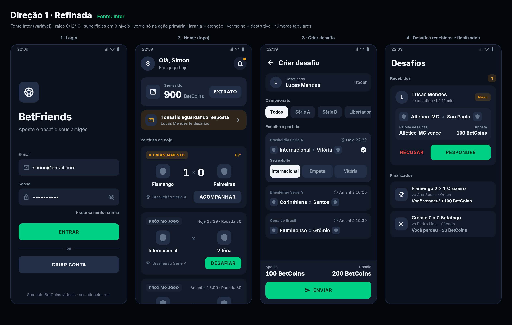
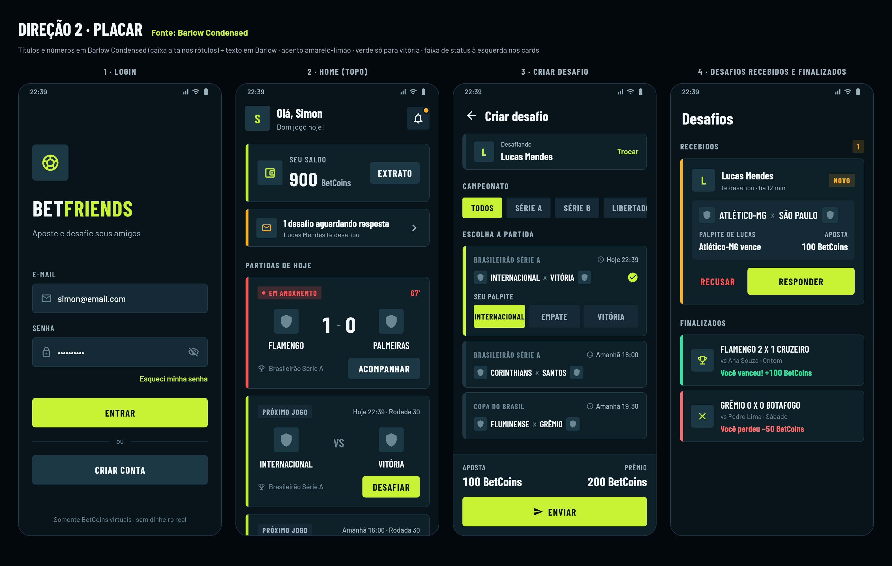
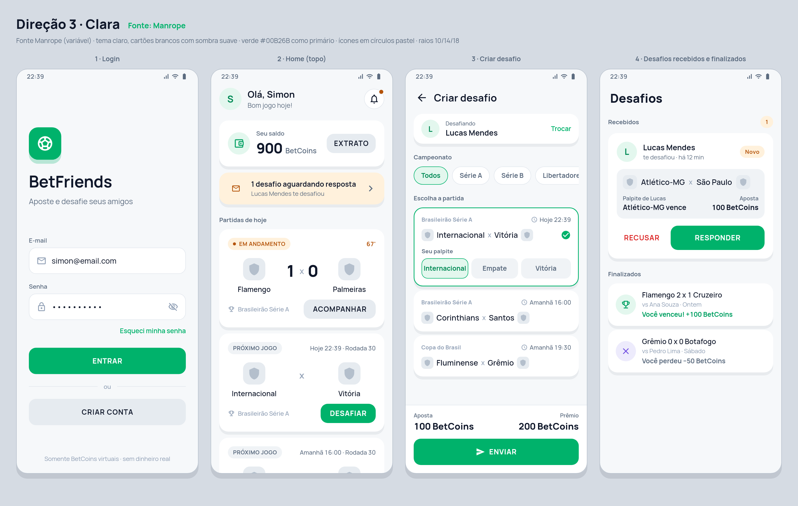
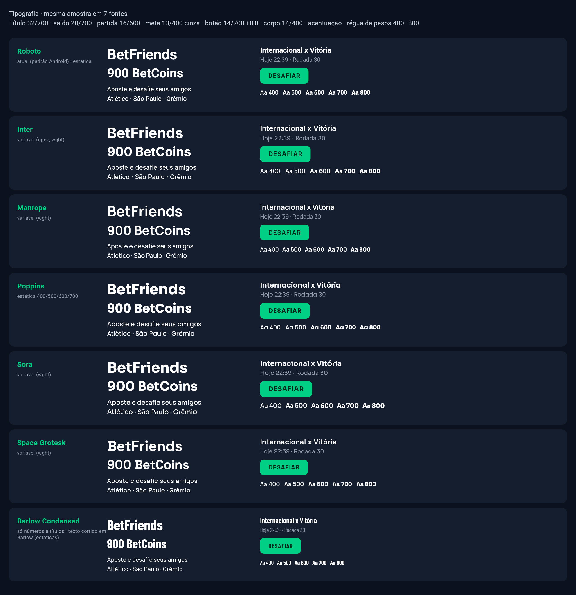

# Direção visual e fonte de marca

**Data:** 23/11/2026 · **Situação:** aguardando decisão do responsável · **Contexto:** pergunta 1 do plano ([`plano-ui.md`](plano-ui.md)): manter o tema escuro com verde-neon ou mudar de linguagem, e se uma fonte de marca é aceitável.

Os mockups abaixo reconstroem os mesmos quatro quadros em cada direção (Login, topo da Home, Criar Desafio e Desafios) com o mesmo conteúdo, para a comparação ser justa. **São desenhos, não implementação.** Itens como "Esqueci minha senha", o sino de notificação e "Trocar" amigo não existem no app.

## Direção 1: Refinada (sugestão)

Mantém o tema escuro com verde-neon, com sistema: fonte Inter, escala de raios 8/12/16, superfícies em 3 níveis, verde só na ação principal, laranja só para atenção, vermelho só para destrutivo, números tabulares, mais respiro e cartões sem borda pesada.

## Direção 2: Placar

Visual de transmissão esportiva: fundo azul-petróleo quase preto, acento amarelo-limão `0xFFC6F135` (o verde fica só para vitória), títulos e números em Barlow Condensed, rótulos em caixa alta e faixa de status à esquerda dos cartões.

## Direção 3: Clara

Tema claro no estilo de app financeiro: fundo `0xFFF6F8FA`, cartões brancos com sombra suave, verde `0xFF00B26B`, fonte Manrope e ícones em círculos pastel.

## Comparação

| | 1. Refinada | 2. Placar | 3. Clara |
|---|---|---|---|
| Ideia | Mesmo escuro com verde, organizado | Transmissão esportiva | Finanças limpo, modo claro |
| Fonte | Inter | Barlow Condensed (títulos e números) e Barlow | Manrope |
| Custo de mudança | Menor: a base atual continua e o tema entra como camada | Médio: troca o acento e a fonte e redesenha os cartões | Alto: refaz o contraste de todas as telas |
| Risco | Pouco | Menos legível em tamanho pequeno; mais "gamer" do que "entre amigos" | Quebra a identidade atual e perde o clima de jogo |

## Fontes

| Fonte | Impressão | Observação |
|---|---|---|
| Roboto (atual) | Neutra, "padrão Android" | Sem personalidade; é o que dá o visual genérico |
| **Inter** | Limpa, muito legível em tela pequena | Ótima para números; pesos 400 a 800 |
| Manrope | Mais arredondada e amigável | Combina com a direção clara |
| Poppins | Geométrica e larga | Gasta largura, o que agrava os nomes cortados |
| Sora | Moderna, um pouco "tech" | Largura média |
| Space Grotesk | Com personalidade nos números | Menos neutra no texto corrido |
| Barlow Condensed | Esportiva e estreita | Boa só para placar, saldo e títulos; ruim no texto corrido |

Todas são livres (SIL OFL), com uso liberado em app. As variáveis (Inter, Manrope, Sora, Space Grotesk) mudam o peso de verdade com `FontVariation('wght')`; as estáticas (Poppins, Barlow) não têm o peso 800.

Tamanho dos arquivos testados: Inter variável 877 KB; Manrope 165 KB; Poppins cerca de 158 KB por peso; Sora 111 KB; Space Grotesk 137 KB; Barlow Condensed cerca de 105 KB por peso.

## Como embarcar a fonte

| Opção | Vantagem | Desvantagem |
|---|---|---|
| Pacote `google_fonts` | Fácil de usar | Baixa a fonte pela internet na primeira vez; com Wi-Fi ruim na demo o app começa na fonte padrão |
| **Arquivo dentro do app** (recomendado) | Funciona offline e igual em todo aparelho | O `.ttf` vai em `assets/fonts/` e é declarado no `pubspec.yaml`; o Inter variável pesa 877 KB |

## Sugestão

1. **Direção 1 (Refinada)** com **Inter** embutida.
2. Opcional, para um toque esportivo sem mudar de direção: **Barlow Condensed só no placar e no saldo**, como no mockup da Direção 2 (mais 4 arquivos de cerca de 100 KB).
3. A Direção 3 só se a equipe quiser um tema claro. O `AppTheme` pode nascer pronto para tema claro e escuro juntos depois.

## Decisão

Pendente. Registrar aqui a escolha da direção e da fonte quando houver.
