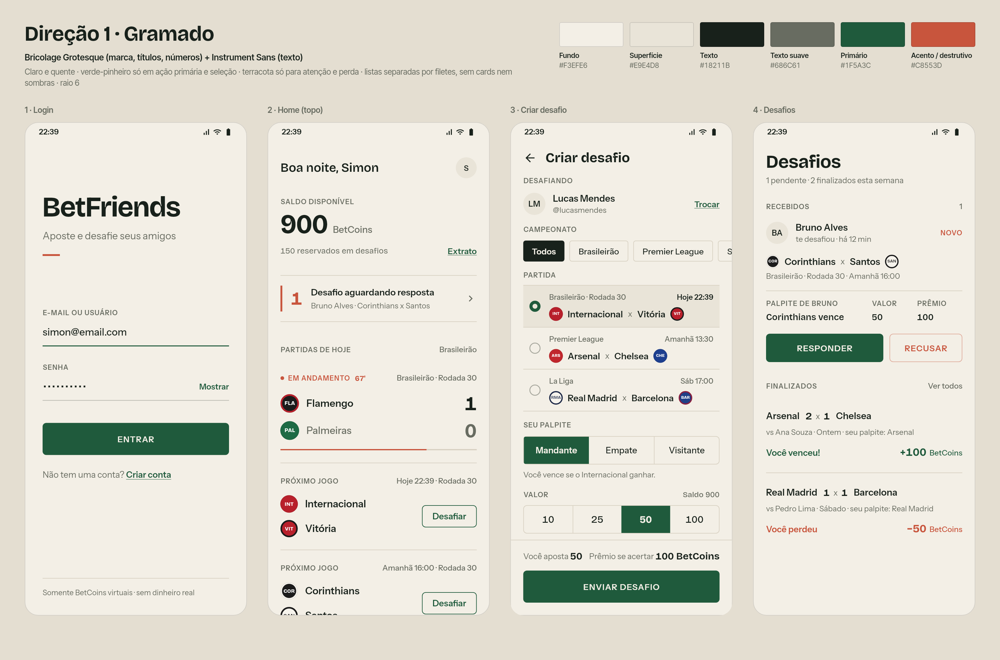
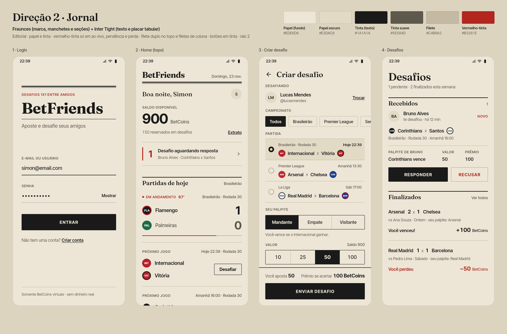
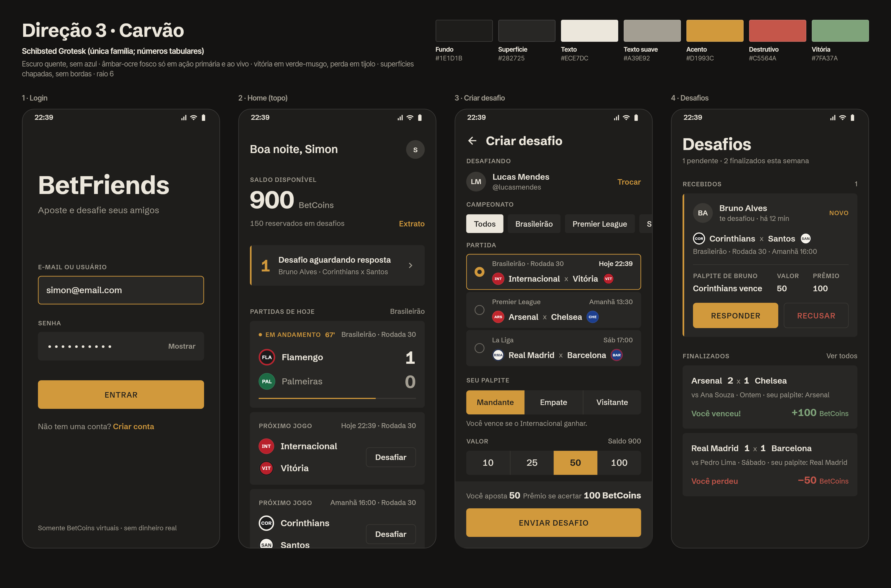
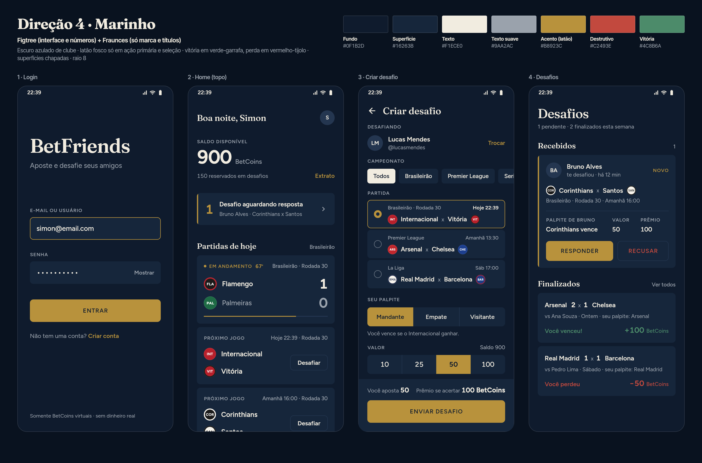
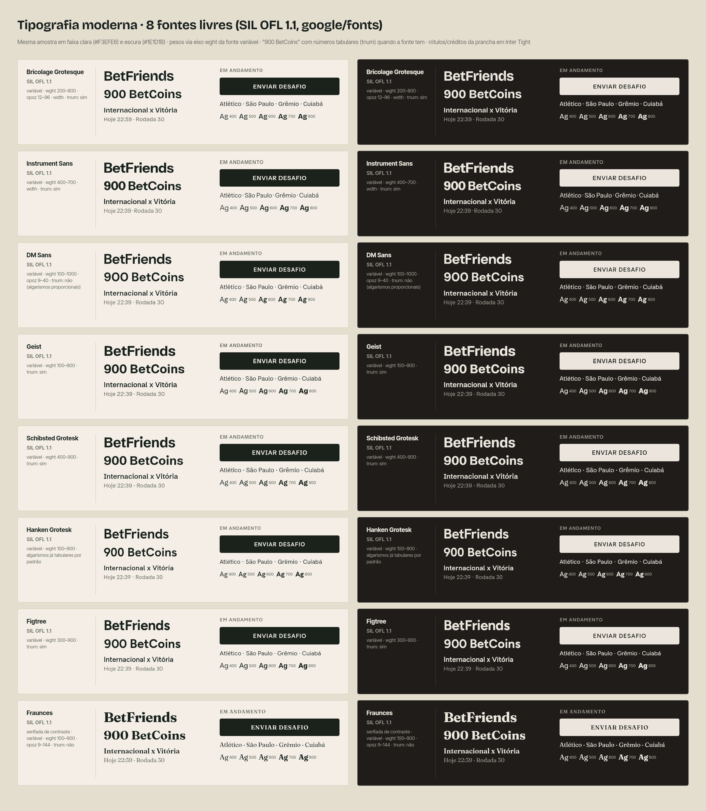

# Direções visuais, segunda rodada: sem neon e com tipografia moderna

**Data:** 23/11/2026 · **Situação:** aguardando decisão do responsável · **Origem:** a primeira rodada ([`direcao-visual.md`](direcao-visual.md)) foi descartada: o responsável não quer neon nem "cara de IA" e quer tipografia moderna. Esta rodada é **só protótipo visual (imagens)**. Nada foi implementado no app.

Cada prancha mostra os mesmos 4 quadros com o mesmo conteúdo: Login, topo da Home, Criar Desafio e Desafios. Os quadros usam só o que o app já faz (sem "esqueci a senha", sem notificações).

## O que mudou em relação à rodada anterior

| Evitado (marcas de "visual de IA") | Adotado |
|---|---|
| Neon e acentos saturados sobre fundo preto-azulado | Paleta curta e terrosa, com uma cor de acento só, usada com parcimônia |
| Brilho, gradiente radial, vidro, sombras coloridas | Superfícies chapadas e filetes finos em vez de caixas |
| Todo card igual, com ícone dentro de quadradinho arredondado | Listas separadas por filetes, hierarquia feita pela tipografia |
| Raios grandes e uniformes (16 a 24) e bordas em todo lugar | Raios pequenos (2 a 8) e poucas bordas |
| Escudo genérico em ícone | Disco com a cor do clube e a sigla de 3 letras, até os escudos reais carregarem |
| Texto centralizado em tudo | Alinhamento à esquerda numa grade clara, com números tabulares |

## Direção 1: Gramado (claro)

Verde-pinheiro profundo como cor primária, terracota como único acento de atenção e perda, fundo off-white quente, filetes no lugar de cards e sem sombras. Fontes: **Bricolage Grotesque** (marca, títulos e números) com **Instrument Sans** (texto).

| Papel | Cor |
|---|---|
| Fundo | `#F3EFE6` |
| Superfície | `#E9E4D8` |
| Texto | `#18211B` |
| Texto suave | `#686C61` |
| Primário | `#1F5A3C` |
| Acento e destrutivo | `#C8553D` |

## Direção 2: Jornal (claro, editorial)

Papel e tinta, vermelho-tinta só para ao vivo, pendência e perda, filete duplo no topo e filetes de coluna como numa página de jornal esportivo. O botão primário é preto. Fontes: **Fraunces** (marca, manchetes e seções, serifada moderna) com **Inter Tight** (texto e placar tabular).

| Papel | Cor |
|---|---|
| Papel (fundo) | `#EDE6D6` |
| Papel escuro | `#E3DAC6` |
| Tinta (texto) | `#1A1A1A` |
| Tinta suave | `#5E584D` |
| Filete | `#C4B9A2` |
| Vermelho-tinta | `#B3261E` |

## Direção 3: Carvão (escuro sóbrio)

Grafite quente, sem azul, com texto osso e âmbar-ocre fosco só na ação primária e no ao vivo. Vitória em verde-musgo e perda em tijolo. Superfícies chapadas e sem bordas. Uma família só: **Schibsted Grotesk**, com números tabulares.

| Papel | Cor |
|---|---|
| Fundo | `#1E1D1B` |
| Superfície | `#282725` |
| Texto | `#ECE7DC` |
| Texto suave | `#A39E92` |
| Acento | `#D1993C` |
| Destrutivo | `#C5564A` |
| Vitória | `#7FA37A` |

## Direção 4: Marinho (escuro, "clube")

Azul-marinho profundo, texto creme e latão fosco, com cara de clube de futebol tradicional. Vitória em verde-garrafa e perda em vermelho-tijolo. Fontes: **Figtree** (interface e números), com **Fraunces** só na marca e nos títulos de seção.

| Papel | Cor |
|---|---|
| Fundo | `#0F1B2D` |
| Superfície | `#16263B` |
| Texto | `#F1ECE0` |
| Texto suave | `#9AA2AC` |
| Acento (latão) | `#B8923C` |
| Destrutivo | `#C2493E` |
| Vitória | `#4C8B6A` |

## Contraste das paletas (WCAG, calculado)

| Direção | Texto | Texto suave | Botão primário | Cores de estado |
|---|---|---|---|---|
| Gramado | 14,4 | 4,7 | 7,1 | **terracota 3,8** (abaixo de 4,5) |
| Jornal | 14,0 | 5,7 | 14,0 | vermelho-tinta 5,3 |
| Carvão | 13,7 | 6,3 | 6,7 | **destrutivo 3,4**; vitória 5,3 |
| Marinho | 14,7 | 6,7 | 5,9 | **destrutivo 3,1**, **vitória 3,8** |

As cores de estado que ficam abaixo de 4,5 precisam de um tom mais claro (nos escuros) ou mais escuro (no claro) quando usadas em texto pequeno. É um ajuste de token na implementação, não muda a direção.

## Fontes modernas

| Fonte | Impressão | Números tabulares | Observação |
|---|---|---|---|
| **Bricolage Grotesque** | Com personalidade, pesos fortes nos títulos | Sim | Variável (peso, tamanho óptico e largura); ótima para marca e números |
| **Instrument Sans** | Limpa, levemente condensada | Sim | Boa para texto corrido ao lado de uma display |
| DM Sans | Geométrica e amigável | **Não** (algarismos proporcionais) | Evitar em placar e saldo |
| Geist | Neutra e atual | Sim | Alternativa segura |
| **Schibsted Grotesk** | Séria, de jornal moderno | Sim | Uma família só serve a interface inteira |
| Hanken Grotesk | Neutra, quase invisível | Já tabulares por padrão | Segura, sem personalidade |
| Figtree | Redonda e acolhedora | Sim | Boa em escuro |
| **Fraunces** | Serifada de contraste, marca editorial | **Não** | Só para marca e títulos, nunca em números |

Todas são livres (SIL OFL 1.1), de `google/fonts`, em versão variável (o peso muda de verdade com o eixo `wght`). Inter Tight e Outfit foram baixadas, mas só a primeira entrou numa prancha (Jornal).

## Escudos dos times

Os discos de cor com a sigla são provisórios. Com os escudos reais, que vêm em PNG com fundo transparente, os temas **claros** (Gramado e Jornal) os mostram direto sobre o papel, sem o quadro branco que hoje pesa no tema escuro. Nos temas **escuros** (Carvão e Marinho) continua valendo a decisão 5 do plano: quadro neutro atrás do escudo ou escudo direto, avaliado com imagens reais no emulador.

## Custo de implementação

| Direção | Custo | Por quê |
|---|---|---|
| Carvão | Menor | Continua escuro, como o app hoje; muda paleta, fonte e formato dos cartões |
| Marinho | Menor a médio | Mesma estrutura escura, com uma serifada nos títulos |
| Gramado | Médio a alto | Tema claro: todos os textos, bordas e estados passam por contraste novo |
| Jornal | Alto | Tema claro, mais um estilo editorial (filetes, serifada) que muda o desenho das telas |

Qualquer uma pode nascer com um `AppTheme` pronto para claro e escuro, para trocar depois sem refazer as telas.

## Sugestão

1. **Gramado** se a equipe topar um tema claro: é a mais distante do visual de template e combina com o futebol (campo e papel). Fonte: Bricolage Grotesque nos títulos e números com Instrument Sans no texto. Corrigir o tom da terracota para texto pequeno.
2. **Carvão** se a equipe preferir continuar no escuro: é a evolução mais segura do app atual, sem neon, e com uma fonte só (Schibsted Grotesk).
3. **Jornal** é a mais autoral, mas a mais arriscada de implementar. **Marinho** funciona, mas fica mais parecida com um app genérico de clube.

## Decisão

Pendente. Registrar aqui a direção e a fonte escolhidas, e se haverá tema claro e escuro.

## Limitações

- São imagens estáticas: sem estados de erro e carregamento, animação, outros tamanhos de tela nem teste com texto grande.
- As siglas nos discos menores (22 px) só ficam legíveis na imagem cheia.
- Na Home do Jornal o terceiro jogo aparece pouco, porque o filete duplo do topo ocupa altura.
- Detalhes dos ajustes de cor e fonte feitos pelo agente na renderização: Instrument Sans no lugar de DM Sans (Gramado), Inter Tight no lugar de Geist (Jornal), Schibsted no lugar de Hanken (Carvão), superfícies e textos levemente clareados nos escuros.
