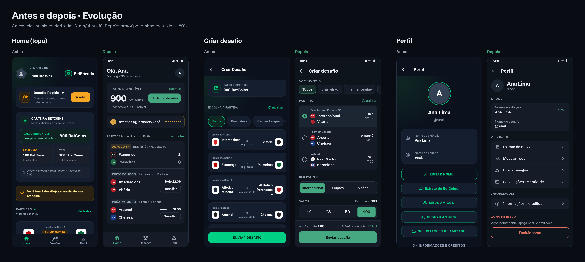
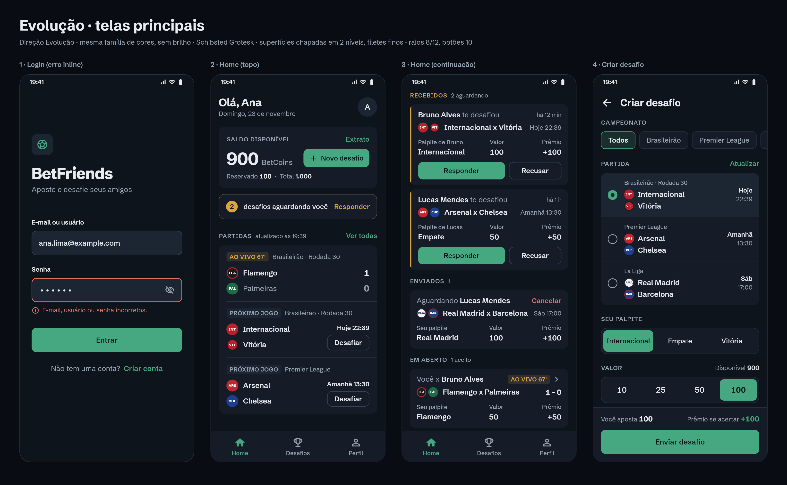
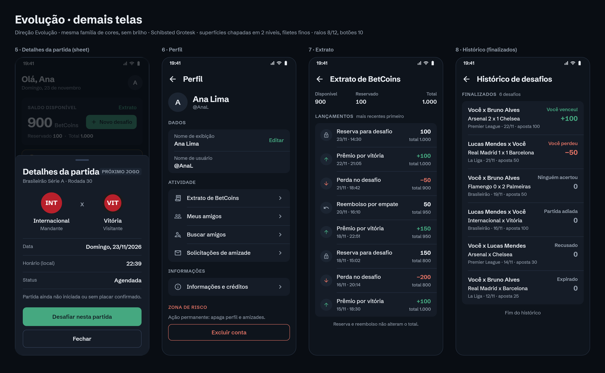
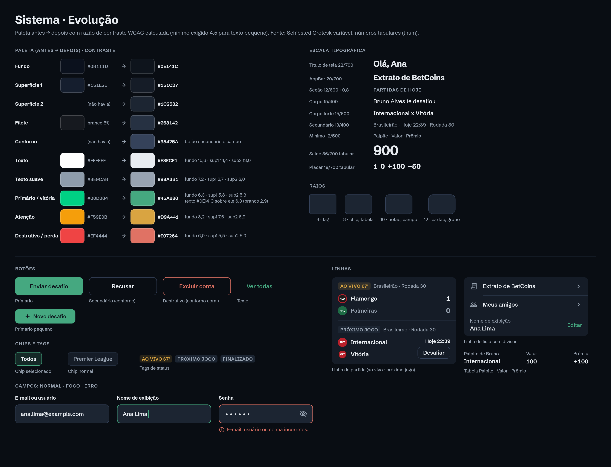
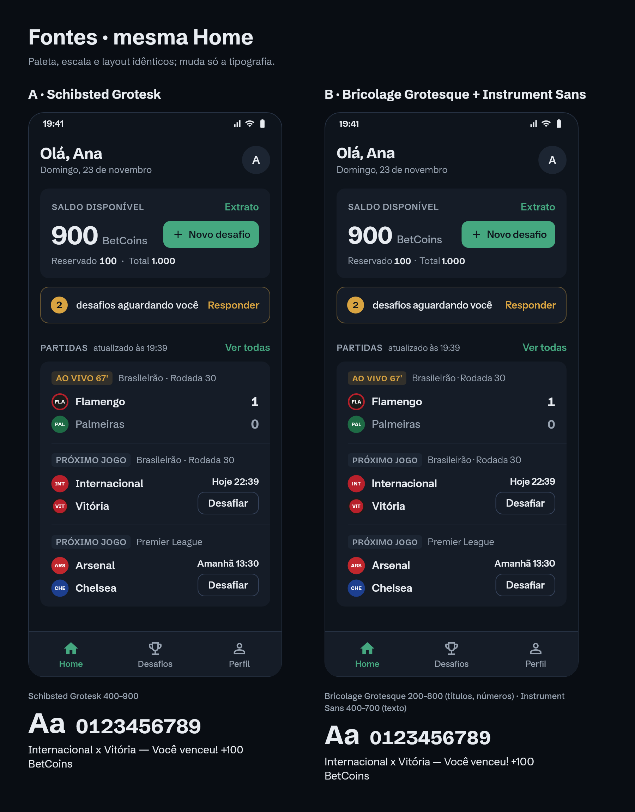

# Direção "Evolução": a paleta atual, sem neon, com a interface melhorada

**Data:** 23/11/2026 · **Situação:** direção implementada; imagens do protótipo preservadas como referência · **Origem:** depois das duas rodadas anteriores ([`direcao-visual.md`](direcao-visual.md), com neon, e [`direcoes-v2.md`](direcoes-v2.md), com paletas novas), o responsável decidiu **manter mais ou menos a paleta atual**, tirar o neon e melhorar a interface. Esta direção parte do app como ele é hoje e corrige os achados de [`auditoria-visual.md`](auditoria-visual.md).

As imagens abaixo são o **protótipo aprovado**, não screenshots. A implementação está registrada ao fim deste documento e no [`plano-ui.md`](plano-ui.md).

## Antes e depois

## Telas principais

## Demais telas

## Sistema de design

### Paleta: mesma família, mais sóbria

O contraste é a razão WCAG sobre o fundo, a superfície 1 e a superfície 2.

| Papel | Antes | Depois | Contraste (fundo / sup. 1 / sup. 2) |
|---|---|---|---|
| Fundo | `#0B111D` | `#0E141C` | — |
| Superfície 1 (cartões, grupos, barra inferior) | `#151E2E` | `#151C27` | — |
| Superfície 2 (campos, avatares, tags, linha selecionada) | não havia | `#1C2532` | — |
| Filete (divisores) | branco a 5% | `#263142` | — |
| Contorno (botão secundário, campo em repouso) | não havia | `#35425A` | — |
| Texto | `#FFFFFF` | `#E8ECF1` | 15,6 / 14,4 / 13,0 |
| Texto suave | `#8E9CAB` | `#98A3B1` | 7,2 / 6,7 / 6,0 |
| Primário e vitória | `#00D084` | `#45A880` | 6,3 / 5,8 / 5,3 |
| Atenção | `#F59E0B` | `#D9A441` | 8,2 / 7,6 / 6,9 |
| Destrutivo e perda | `#EF4444` | `#E07264` | 6,0 / 5,5 / 5,0 |

- O texto sobre o verde primário é escuro (`#0E141C`, contraste 6,3). Branco sobre ele daria só 2,9.
- Com a paleta nova, **nenhum par de texto fica abaixo de 4,5**. O vermelho antigo `#EF4444` dava 4,44 sobre cartão.
- Saíram o brilho, o gradiente radial verde no fundo, as sombras coloridas e a borda branca em todo cartão. As superfícies são chapadas, em 2 níveis, separadas por filetes.

### Tipografia e formas

| Item | Valor |
|---|---|
| Fonte principal (A) | **Schibsted Grotesk**, variável, números tabulares em saldo, placar, valor e prêmio |
| Fonte alternativa (B) | Bricolage Grotesque (títulos e números) com Instrument Sans (texto) |
| Título de tela | 22 / 700 |
| Título de AppBar | 20 / 700 |
| Seção | 12 / 600, caixa alta, espaçamento 0,8 |
| Corpo | 15 / 400 (forte 15 / 600) |
| Secundário | 13 / 400 |
| Mínimo | 12 |
| Saldo | 36 / 700 tabular |
| Raios | 4 (tag), 8 (chip, tabela), 10 (botão, campo), 12 (cartão, grupo) |

Antes havia 21 tamanhos de fonte e 11 raios; o sistema define uma escala-alvo de 7 tamanhos (12, 13, 15, 18, 20, 22 e 36) e 4 raios.

### Fontes lado a lado

A diferença é sutil. **A** (Schibsted, uma família só) é mais neutra, mais simples de manter e tem números tabulares. **B** dá mais personalidade aos títulos e aos números grandes, ao custo de duas famílias. Sugestão: **A**, por simplicidade. **B** se a equipe quiser mais caráter na marca.

## Melhorias de interface aplicadas

| Achado da auditoria | O que o protótipo faz |
|---|---|
| 2, 16: a Home enterra o conteúdo; cabeçalho desalinhado | Saudação à esquerda e avatar com inicial à direita; **um** bloco de saldo (disponível grande, "Reservado 100 · Total 1.000" numa linha, link "Extrato"); **um** aviso de pendência fino; partidas logo depois |
| 11: hierarquia de cores ambígua | Verde só em ação primária, seleção e vitória; âmbar só para atenção e ao vivo; coral só para destrutivo e perda. "Desafiar" vira botão secundário de contorno |
| 4, 13: nomes de times cortados e quebrados | Partidas em duas linhas (mandante em cima, visitante embaixo), nome em até 2 linhas, placar à direita, tag de status e liga em texto suave |
| 2: card "Desafio Rápido" e "MAIS PARTIDAS" | "Novo desafio" como botão primário pequeno junto ao saldo; "Ver todas" como link |
| Desafios em parágrafos que quebram | Linhas estruturadas: quem, partida e uma tabela "Palpite · Valor · Prêmio"; Responder (primário) e Recusar (secundário) com hierarquia clara |
| 7, 8: campos sem rótulo, erro em SnackBar | Rótulo acima do campo, filete verde no foco, erro inline em coral com ícone |
| 5: AppBar e telas novas inconsistentes | AppBar único (seta e título 20/700 à esquerda) em todas as telas, inclusive Extrato e Histórico |
| 12: Perfil com 5 botões iguais | Lista agrupada com divisores (Dados, Atividade, Informações) e **zona de risco** separada para "Excluir conta" |
| 5: Extrato só com texto | Linhas com glifo por tipo, descrição, data pequena, valor à direita com sinal e cor, e saldo após em texto suave |
| 13: detalhes da partida | Bottom sheet com os dois clubes em colunas, data e horário em linhas claras, ação primária "Desafiar nesta partida" e secundária "Fechar" |
| 5: Histórico com o mesmo botão em todas as linhas | Resultado e valor alinhados à direita (vitória em verde, perda em coral, empate e outros neutros) |

## Ajustes em relação ao pedido

- O coral ficou em `#E07264` (o pedido era `#D9675B`, que dava 4,44 sobre a superfície 2).
- Criei o token de **contorno** `#35425A`, porque o filete sumia como borda de botão secundário e de campo.
- Tags de status com raio 4; com raio 8 viravam pílula.
- Números tabulares só em números puros: em "1.000", "22:39" e datas, a Schibsted dá ao ponto e aos dois-pontos a largura de um dígito.
- Botões em caixa normal ("Enviar desafio"), não em caixa alta.
- Nas partidas que ainda não começaram, o horário e o "Desafiar" ficam na coluna da direita, onde no jogo ao vivo fica o placar.
- O palpite mostra o nome dos times ("Internacional · Empate · Vitória"), em vez de "Mandante" e "Visitante".
- O "Prêmio" é o ganho líquido (+100 para aposta de 100), coerente com "Você venceu! +100 BetCoins" e com a regra sem taxa.

## Comportamentos implementados

Ao iniciar a implementação, foram aplicadas as sugestões do protótipo:

1. **Recusar direto na lista de recebidos**, sempre com confirmação. A recusa no modal continua disponível; ambas usam a mesma rotina de serviço.
2. **Prêmio líquido em cada desafio**: +100 para aposta de 100, sem alterar as regras de BetCoins.

Os demais pontos reorganizam a Home e a navegação, e são as decisões 2 e 3 do [`plano-ui.md`](plano-ui.md).

## Limitações das imagens do protótipo

- Imagens estáticas, sem estados de carregamento, sem animação e sem teste com fonte do sistema ampliada.
- Os clubes aparecem como discos com sigla, não como escudos reais.
- No quadro "Home (continuação)", o último cartão fica rente à barra inferior.
- Os "antes" vêm das renderizações da auditoria e os dois lados estão reduzidos a 80%.

## Decisão

Implementação autorizada pelo responsável, com ajuste de logo deixado a critério técnico. Aplicados: Evolução, fonte A (Schibsted Grotesk), reorganização da Home, aba Desafiar, kit original aparado e fundo neutro dos escudos. As sugestões não respondidas individualmente foram adotadas como padrão; ver o quadro do plano.

## Evidências da implementação

Telas reais renderizadas com a fonte embutida, sem Firebase e sem acesso à rede. Os discos com siglas são o fallback; escudos reais continuam vindo do provedor. Ícone e splash nativos precisam de conferência no Android.

| Tela | Antes | Implementação |
|---|---|---|
| Home | [Auditoria](imagens/auditoria/01-home-topo.png) | [Home](imagens/implementacao/home.png) · [320 dp, texto 2×](imagens/implementacao/home-320-texto2x.png) |
| Login | [Auditoria](imagens/auditoria/07-login-erro.png) | [Login](imagens/implementacao/login.png) |
| Cadastro | [Auditoria](imagens/auditoria/09-cadastro.png) | [Cadastro](imagens/implementacao/cadastro.png) |
| Criar desafio | [Auditoria](imagens/auditoria/05-criar-desafio-pagina-inteira.png) | [Criar desafio](imagens/implementacao/criar-desafio.png) |
| Partida | [Auditoria](imagens/auditoria/10-detalhes-da-partida.png) | [Bottom sheet](imagens/implementacao/partida.png) |
| Aceitar desafio | [Auditoria](imagens/auditoria/11-modal-aceitar-desafio.png) | [Aceite](imagens/implementacao/aceitar.png) |
| Perfil | [Auditoria](imagens/auditoria/14-perfil.png) | [Perfil](imagens/implementacao/perfil.png) |
| Extrato | [Auditoria](imagens/auditoria/12-extrato.png) | [Extrato](imagens/implementacao/extrato.png) |
| Histórico | [Auditoria](imagens/auditoria/13-historico.png) | [Histórico](imagens/implementacao/historico.png) |
| Amigos | [Auditoria](imagens/auditoria/16-amigos-lista.png) | [Amigos](imagens/implementacao/amigos.png) |
| Busca | [Auditoria](imagens/auditoria/17-amigos-buscar.png) | [Busca](imagens/implementacao/buscar.png) |
| Solicitações | — | [Solicitações](imagens/implementacao/solicitacoes.png) |

Verificação integrada: análise estática sem problemas, **644 testes passando**, incluindo 48 cenários de layout em 320/360 dp com texto 1×/2×. Harness descartável: **64 capturas sem erros registrados**. Não houve deploy nem alteração das regras do backend.
